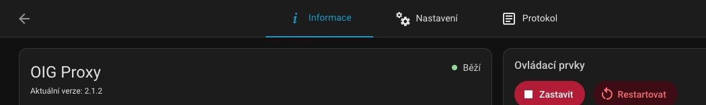
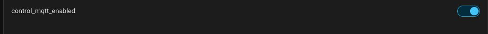
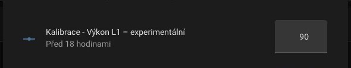

# Lokální ovládání OIG Boxu v Home Assistantu

> [!WARNING]
> **Experimentální funkce v kandidátu `2.2.0-rc.3`.**
> Zápisy mění režim boxu, nabíjení baterie a dodávku do sítě.
> Nastavení měníte na vlastní odpovědnost. Tento kandidát zatím neprošel
> provozní zkouškou na fyzickém boxu. Před zapojením automatizace ověřte ruční
> příkaz, potvrzenou hodnotu a skutečné chování na své instalaci.

## Povolení v OIG Proxy

1. V HA otevřete **Nastavení → Aplikace → OIG Proxy → Nastavení**.
   Ve starších verzích HA se nabídka **Aplikace** jmenuje **Doplňky**.
2. Zapněte `control_mqtt_enabled`. Pro první ověření profilu nastavte
   `proxy_mode: hybrid`. Volby proudu, přetoků a fází nastavte podle parametrů,
   které chcete ovládat. Nastavení uložte a restartujte OIG Proxy.
3. V **Nastavení → Zařízení a služby → Entity** vyhledejte `control_ver_ready`
   a `control_ver_reason`. Ovládání používejte po přechodu na `on` a `ready`.




Snímky pocházejí z HA s testovacím prototypem. Verze na obrazovce aplikace je
verze evidovaná Supervisorem. Nové volby níže popisují RC3.

<!-- markdownlint-disable MD013 -->
| Volba | Výchozí hodnota | K čemu slouží |
| --- | --- | --- |
| `control_mqtt_enabled` | `false` | Povolí místní zápisy parametrů boxu přes MQTT. |
| `ac_charge_max_a` | `0` | Kladný limit povolí zápis `AAC_MAX_CHRG` v celých ampérech od nuly do tohoto limitu, nejvýše 125 A. |
| `grid_export_max_w` | `0` | Kladný limit povolí zápis `P_MAX_FEED_GRID` v celých wattech od 1 do zadaného limitu a tři přepínače přetoků. |
| `phase_calibration_enabled` | `false` | Povolí experimentální zápis korekcí L1, L2 a L3. |
| `maxfg_as_export_limit_readback` | `false` | Použije čerstvé `MAXFG` pro stav limitu přetoků po přijetí přímé hodnoty z tabulky boxu. Zapněte po ověření shody obou hodnot na vlastní instalaci. |
<!-- markdownlint-enable MD013 -->

Stropy v aplikaci omezují hodnoty příkazů. Hodnotu uloženou v boxu nastavíte
příslušnou entitou `_cfg`. Pro první ověření kontrolního součtu `ver` potřebuje
proxy čerstvé rámce boxu, údaj o firmwaru a cloudový zápis potvrzený boxem.
Ověřený profil lze znovu potvrdit z čerstvých dat po restartu.
Po ověření profilu fungují také místní příkazy v offline režimu.

## Změna režimu

1. V registru **Nastavení → Zařízení a služby → Entity** vyhledejte
   `tbl_box_prms_mode` a zkontrolujte sloupec **Integrace**, který má ukazovat
   **MQTT**.
2. Otevřete entitu typu `select`, jejíž ID končí na `tbl_box_prms_mode_cfg`.
   Z rozbalovací nabídky vyberte například **Home 2**.
3. Vyčkejte na potvrzený režim v senzoru `tbl_box_prms_mode`. Při první
   zkoušce můžete stejným postupem vrátit původní režim.


Snímek ukazuje nabídku ověřovaného prototypu. RC3 přidává do výběru také Home 5
a Home 6. Fyzické přepnutí těchto dvou režimů přes RC3 zatím čeká na ověření.

| Hodnota MQTT | 0 | 1 | 2 | 3 | 4 | 5 |
| --- | --- | --- | --- | --- | --- | --- |
| Režim boxu | Home 1 | Home 2 | Home 3 | Home UPS | Home 5 | Home 6 |

## Nabíjení v Home UPS

1. Požádejte o Home UPS a vyčkejte na potvrzení v senzoru režimu.
2. Vyhledejte `aac_max_chrg` a otevřete MQTT entitu typu `number` s příponou
   `_cfg`. Zadejte proud odpovídající stropu instalace.
3. Ověřte hodnotu `AAC_MAX_CHRG` v senzoru. Tato hodnota vyjadřuje nastavený
   limit nabíjení ze sítě. Okamžitý proud baterie ukazuje `BAT_I` a její
   výkon `BAT_P`. Po další změně režimu limit znovu zkontrolujte.


## Přetoky do sítě

1. V `p_max_feed_grid_cfg` nastavte limit ve wattech a zkontrolujte, že
   senzor `P_MAX_FEED_GRID` hlásí stejnou hodnotu.
2. `TO_GRID` řídí povolení dodávky do sítě. Pro vybíjení baterie do sítě
   použijte `GRID_PV_OFF` bez výroby FVE nebo `GRID_PV_ON` při dostupné výrobě.
   Každý z těchto přepínačů používá `0` pro vypnutí a `1` pro zapnutí.
3. Po změně ověřte potvrzený příznak i skutečný tok do sítě.

## Fázové korekce L1, L2 a L3

Vyhledejte `p_cal` pod zařízením **Střídač**. Zapisujte přes příslušnou
entitu `number` s příponou `_cfg`. Po každé změně ověřte senzor stejné fáze.



| Fáze | Parametr | Povolené zápisy v RC3 |
| --- | --- | --- |
| L1 | `tbl_invertor_prm1:P_CAL_R` | 0, 50, 75, 90 |
| L2 | `tbl_invertor_prm1:P_CAL_S` | 90 |
| L3 | `tbl_invertor_prm1:P_CAL_T` | 90 |

Hodnoty jsou v surových jednotkách boxu. Převod na fyzikální jednotku zatím
nemáme ověřený. Atribut `allowed_values` uvádí přesné povolené zápisy.
Ovladač může ukazovat i dříve potvrzenou hodnotu mimo tento seznam, například
75 na L2 či L3. Tuto hodnotu RC3 přes MQTT nenastaví zpět.

## Automatizace Home UPS a AAC

V HA vytvořte skript a nahraďte ukázková ID skutečnými ID svého boxu z registru
MQTT entit. `100` je proud z fyzické zkoušky jedné instalace. Použijte hodnotu
v povoleném rozsahu svého boxu.

```yaml
alias: OIG - Home UPS a 100 A
mode: single
sequence:
  - condition: state
    entity_id: binary_sensor.oig_local_oig_proxy_proxy_status_control_ver_ready
    state: "on"
  - if:
      - condition: not
        conditions:
          - condition: state
            entity_id: sensor.oig_local_1234567890_tbl_box_prms_mode
            state: "Home UPS"
    then:
      - action: select.select_option
        target:
          entity_id: select.oig_local_1234567890_tbl_box_prms_mode_cfg
        data:
          option: "Home UPS"
      - wait_template: >
          {{ is_state('sensor.oig_local_1234567890_tbl_box_prms_mode',
                      'Home UPS') }}
        timeout: "00:02:00"
        continue_on_timeout: false
  - action: number.set_value
    target:
      entity_id: number.oig_local_1234567890_tbl_invertor_prm1_aac_max_chrg_cfg
    data:
      value: 100
  - wait_template: >
      {{ states('sensor.oig_local_1234567890_tbl_invertor_prm1_aac_max_chrg')
         | float(-1) == 100 }}
    timeout: "00:02:00"
    continue_on_timeout: false
```

Pro přímý zápis použijte akci `mqtt.publish`. Nahraďte ukázkové ID v topicu
skutečným ID boxu. Ukázka požádá o Home UPS.

```yaml
action: mqtt.publish
data:
  topic: oig_local/1234567890/set/tbl_box_prms/MODE
  payload: "3"
  qos: 0
  retain: false
```

Po potvrzení Home UPS pošlete proud jako samostatný příkaz na
`oig_local/1234567890/set/tbl_invertor_prm1/AAC_MAX_CHRG`
s payloadem `"100"` a stejnými hodnotami `qos` a `retain`.

## Potvrzení a diagnostika

- **Control - poslední výsledek** (`control_last_result`) ukazuje výsledek a
  atributy příkazu. `ack` potvrzuje přijetí. Před závislým krokem ověřte
  skutečný stav v senzoru.
- Při `nack`, `timeout` nebo `dropped` ověřte výsledek, čas a stav boxu.
  Pokud se výsledek neaktualizoval, podívejte se do záložky **Protokol** aplikace.
- Při `cloud_evidence_pending` chybí potvrzený cloudový zápis pro profil.
  Při `firmware_unverified` proxy čeká na čerstvý údaj o firmwaru.
  Při `box_evidence_stale` potřebuje nová data boxu.

## Co jsme ověřili

- Fyzický prototyp přepnul Home 1 → Home 2 → Home 1 i bez cloudu. Box potvrdil
  režimy. Na téže instalaci potvrdil proudy 100 a 125 A i limity 2 000 a
  5 333 W.
- Při zkoušce bez FVE a limitu 2 000 W box po `GRID_PV_OFF=1` naměřil zhruba
  1,94 až 1,98 kW dodávky ve třech vzorcích. Při krátké zkoušce `GRID_PV_ON`
  potvrdil příkaz střídač. Čerstvá tabulka s hodnotou `1` tehdy chyběla.
- Box potvrdil `90/90/90` pro L1, L2 a L3. Během dvouminutové zkoušky hlásil
  odběr 0 až 26 W. Zátěž se během zkoušky měnila.
- RC3 prošel automatickými testy a ověřením MQTT s Mosquittem. Živá zkouška
  tohoto sestavení na boxu zatím zbývá.

[Konfigurace aplikace](configuration.md) · [Technický popis MQTT a profilu ver](twin.md)
