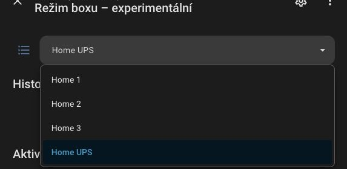
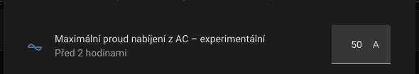

# Lokální ovládání OIG Boxu v Home Assistantu

> [!WARNING]
> **Experimentální lokální ovládání.**
> Zápisy mění režim boxu, nabíjení baterie a dodávku do sítě.
> Nastavení měníte na vlastní odpovědnost. Před zapojením automatizace ověřte
> ruční příkaz, potvrzenou hodnotu a skutečné chování na své instalaci.

## Povolení v OIG Proxy

1. V HA otevřete **Nastavení → Aplikace → OIG Proxy → Nastavení**.
   Ve starších verzích HA se nabídka **Aplikace** jmenuje **Doplňky**.
2. Zapněte `control_mqtt_enabled`. Pro první ověření profilu nastavte
   `proxy_mode: hybrid`. Volby proudu, přetoků a fází nastavte podle parametrů,
   které chcete ovládat. Nastavení uložte a restartujte OIG Proxy.
3. V **Nastavení → Zařízení a služby → Entity** najděte zařízení
   **Diagnostika OIG (oig_proxy)** pod integrací **MQTT**. Vyhledejte
   **Lokální zápis – ověřený profil ver** (`control_ver_ready`) a
   **Lokální zápis – důvod stavu profilu ver** (`control_ver_reason`).
   Ovládání použijte, až budou jejich stavy `on` a `ready`.


Snímky pocházejí z HA s testovacím prototypem. Verze na obrazovce aplikace je
verze evidovaná Supervisorem.

<!-- markdownlint-disable MD013 -->
| Volba | Výchozí hodnota | K čemu slouží |
| --- | --- | --- |
| `control_mqtt_enabled` | `false` | Povolí místní zápisy parametrů boxu přes MQTT. |
| `ac_charge_max_a` | `0` | Kladný limit povolí zápis `AAC_MAX_CHRG` v celých ampérech od nuly do tohoto limitu, nejvýše 125 A. |
| `grid_export_max_w` | `0` | Kladný limit povolí zápis `P_MAX_FEED_GRID` v celých wattech od 1 do zadaného limitu a tři přepínače přetoků. |
| `phase_calibration_enabled` | `false` | Povolí experimentální zápis korekcí L1, L2 a L3. |
| `maxfg_as_export_limit_readback` | `false` | Použije čerstvé `MAXFG` pro stav limitu přetoků po přijetí přímé hodnoty z tabulky boxu. Zapněte po ověření shody obou hodnot na vlastní instalaci. |
<!-- markdownlint-enable MD013 -->

Stropy v aplikaci omezují hodnoty příkazů. Hodnotu uloženou v boxu nastavíte
příslušnou entitou `_cfg`. Pro první ověření kontrolního součtu `ver` potřebuje
proxy čerstvé rámce boxu a cloudový zápis potvrzený boxem na stejném spojení.
RC4 může profil ověřit i bez aktuálního údaje o firmwaru.
Pokud čeká na cloudový důkaz, proveďte běžnou změnu z cloudu a ověřte,
že ji box potvrdil. Proxy může po restartu nebo aktualizaci ověřený profil znovu
potvrdit z čerstvých dat boxu. Dokud je profil připravený, může proxy
odesílat příkazy i bez cloudu. [Režimy proxy](proxy_modes.md)

U režimu boxu, proudu, přetoků a povolených fázových korekcí uvidíte senzor
pro čtení a vedle něj ovladač s příponou `_cfg`. Oba používají stav hlášený
boxem. Požadavek odešlete ovladačem. Senzor se změní po novém potvrzení.
V HA mohou mít obě entity stejný název. Rozlište je podle typu a ID.
Vlastní názvy v registru nebo na panelu se mohou lišit od ukázek.
Pokud po snížení stropu nebo vypnutí zápisů zůstane na panelu starší
ovladač, platí omezení z nastavení proxy.

## Změna režimu

1. V registru **Nastavení → Zařízení a služby → Entity** vyhledejte
   `tbl_box_prms_mode` a zkontrolujte sloupec **Integrace**, který má ukazovat
   **MQTT**.
2. Otevřete **Režim** typu `select`, jehož ID končí na `tbl_box_prms_mode_cfg`.
   Z rozbalovací nabídky vyberte například **Home 2**. Režimy připojení
   `online`, `hybrid` a `offline` najdete v samostatném ovladači **Proxy - Režim**.
3. Vyčkejte na potvrzený režim v senzoru `tbl_box_prms_mode`. Při první
   zkoušce můžete stejným postupem vrátit původní režim.



Snímek ukazuje nabídku ověřovaného prototypu. V RC4 jsou v nabídce také Home 5
a Home 6. Fyzické přepnutí těchto dvou režimů zatím čeká na ověření.

| Hodnota MQTT | 0 | 1 | 2 | 3 | 4 | 5 |
| --- | --- | --- | --- | --- | --- | --- |
| Režim boxu | Home 1 | Home 2 | Home 3 | Home UPS | Home 5 | Home 6 |

## Nabíjení v Home UPS

1. Požádejte o Home UPS a vyčkejte na potvrzení v senzoru režimu.
2. Vyhledejte `aac_max_chrg`. Pod zařízením **Baterie** otevřete
   **Nabíječka - Max. AC proud** typu `number` s příponou `_cfg`.
   Hned po potvrzení režimu zadejte proud v mezích své instalace.
3. Ověřte hodnotu `AAC_MAX_CHRG` v senzoru. Tato hodnota vyjadřuje nastavený
   limit nabíjení ze sítě. Okamžitý proud baterie ukazuje `BAT_I` a její
   výkon `BAT_P`. Po další změně režimu limit znovu zkontrolujte.



Snímek ukazuje číselné pole prototypu. V RC4 hledejte název
**Nabíječka - Max. AC proud** nebo ID obsahující `aac_max_chrg`.

## Přetoky do sítě

1. Pod zařízením **Síť** otevřete **Síť - Max. výkon do sítě**
   (`p_max_feed_grid_cfg`). Nastavte limit ve wattech podle povoleného
   přetoku své instalace. S dalším krokem počkejte na jeho potvrzení v senzoru.
2. **Síť - Dodávka aktivní** (`TO_GRID`) povoluje dodávku do sítě. Ověřte
   jeho potvrzený stav. Podle stavu FVE použijte **Síť - Vybíjení bat. bez FVE**
   (`GRID_PV_OFF`) nebo **Síť - Vybíjení bat. s FVE** (`GRID_PV_ON`). Jde o dva
   samostatné přepínače. Každý používá `0` pro vypnutí a `1` pro zapnutí.
3. Po změně ověřte potvrzený příznak a čerstvé měření toku do sítě. Předaná
   hodnota limitu je nastavení boxu. Skutečný přetok ověřte měřením výkonu
   v místě připojení nebo na elektroměru, který tuto hodnotu ukazuje.
4. Po zkoušce vypněte zkušební vybíjení a ověřte příznaky i tok do sítě.
   Pokud jste měnili další nastavení, vraťte původní hodnoty v povoleném
   rozsahu a ověřte jejich potvrzení.

Při přímém ovládání použijte akci `mqtt.publish` z příkladu níže.
Limit se posílá na `oig_local/<ID_BOXU>/set/tbl_invertor_prm1/P_MAX_FEED_GRID`.
Přepínače mají vlastní topicy pod `oig_local/<ID_BOXU>/set/tbl_invertor_prms/`,
například `GRID_PV_OFF` s payloadem `"1"`. Závislé příkazy posílejte postupně,
po potvrzení předchozí změny.

## Fázové korekce L1, L2 a L3

Vyhledejte `p_cal` pod zařízením **Střídač**. Zapisujte přes příslušnou
entitu `number` s příponou `_cfg`. Po každé změně ověřte senzor stejné fáze.


| Fáze | Parametr | Povolené zápisy v RC4 |
| --- | --- | --- |
| L1 | `tbl_invertor_prm1:P_CAL_R` | 0, 50, 75, 90 |
| L2 | `tbl_invertor_prm1:P_CAL_S` | 90 |
| L3 | `tbl_invertor_prm1:P_CAL_T` | 90 |

Hodnoty jsou v surových jednotkách boxu. Převod na fyzikální jednotku zatím
nemáme ověřený. V detailech ovladače `_cfg` uvádí atribut `allowed_values`
přesné povolené zápisy. Číselné pole má širší rozsah kvůli dříve potvrzeným
hodnotám, například 75 na L2 či L3. Proxy při zápisu přijímá jen hodnoty
z tabulky. Před změnou si zapište stav každé fáze a ověřte způsob návratu.
Hodnotu 75 na L2 nebo L3 přes MQTT v RC4 neobnovíte.

## Automatizace Home UPS a AAC

V HA vytvořte skript a nahraďte ukázková ID skutečnými ID svého boxu z registru
MQTT entit. `100` je proud z fyzické zkoušky jedné instalace. Použijte hodnotu
v povoleném rozsahu svého boxu. Skript nastaví cílový stav a přeskočí krok,
pokud příslušný senzor již ukazuje cílovou hodnotu. Po přechodu do Home UPS
ověřte také skutečný proud baterie. Pokud potřebujete znovu poslat stejnou
hodnotu, potvrzení tohoto nového příkazu ověřujte zvlášť podle výsledku a
nové zprávy boxu.

```yaml
alias: OIG - Home UPS a 100 A
mode: single
sequence:
  - condition: state
    entity_id: binary_sensor.oig_local_oig_proxy_proxy_status_control_ver_ready
    state: "on"
  - if:
      - condition: not
        conditions:
          - condition: state
            entity_id: sensor.oig_local_1234567890_tbl_box_prms_mode
            state: "Home UPS"
    then:
      - action: select.select_option
        target:
          entity_id: select.oig_local_1234567890_tbl_box_prms_mode_cfg
        data:
          option: "Home UPS"
      - wait_template: >
          {{ is_state('sensor.oig_local_1234567890_tbl_box_prms_mode',
                      'Home UPS') }}
        timeout: "00:05:00"
        continue_on_timeout: false
  - if:
      - condition: template
        value_template: >
          {{ states('sensor.oig_local_1234567890_tbl_invertor_prm1_aac_max_chrg')
             | float(-1) != 100 }}
    then:
      - action: number.set_value
        target:
          entity_id: number.oig_local_1234567890_tbl_invertor_prm1_aac_max_chrg_cfg
        data:
          value: 100
      - wait_template: >
          {{ states('sensor.oig_local_1234567890_tbl_invertor_prm1_aac_max_chrg')
             | float(-1) == 100 }}
        timeout: "00:02:00"
        continue_on_timeout: false
```

Pro přímý zápis použijte akci `mqtt.publish`. Nahraďte ukázkové ID v topicu
skutečným ID boxu. Ukázka požádá o Home UPS.

```yaml
action: mqtt.publish
data:
  topic: oig_local/1234567890/set/tbl_box_prms/MODE
  payload: "3"
  qos: 0
  retain: false
```

Po potvrzení Home UPS pošlete proud jako samostatný příkaz na
`oig_local/1234567890/set/tbl_invertor_prm1/AAC_MAX_CHRG`
s payloadem `"100"` a stejnými hodnotami `qos` a `retain`.

## Potvrzení a diagnostika

- **Control - poslední výsledek** (`control_last_result`) ukazuje například
  `ack tbl_box_prms:MODE=3`. V atributech najdete mimo jiné `event_id`, čas
  `at`, `source` (`local` nebo `cloud`) a druh potvrzení `evidence`.
  `ack` s `protocol_ack` potvrzuje přijetí rámce. Použitou hodnotu ověřte
  v odpovídajícím senzoru podle zprávy boxu. Poslední výsledek může patřit
  jinému příkazu, proto porovnejte také tabulku, parametr, hodnotu a čas.
- Od RC5 aktualizuje událost boxu `HG … Start` senzor režimu i jeho ovladač
  `_cfg` hned po přijetí. Platí pro Home 1, Home 2, Home 3 a Home UPS.
  Starší tabulka parametrů novější potvrzený režim nepřepíše.
- Při `nack`, `timeout` nebo `dropped` ověřte výsledek, čas a stav boxu.
  Pokud se výsledek neaktualizoval, podívejte se do záložky **Protokol** aplikace.
  Neplatný nebo nepovolený vstup se může objevit jen v protokolu.
- Při `cloud_evidence_pending` chybí potvrzený cloudový zápis pro profil.
  Při `box_evidence_stale` potřebuje nová data boxu.
  Pokud box ohlásí změnu firmwaru, proxy profil ověří znovu.
- Po restartu může HA zobrazit poslední potvrzený stav z cache.
  Pro ověření nové změny sledujte zprávu přijatou po příkazu. S čekáním
  na vhodný dotaz boxu se i samotné odeslání může zpozdit.

## Návrat po zkoušce

Před prvním zápisem si poznamenejte potvrzené hodnoty, které chcete po zkoušce
obnovit, a zkontrolujte, že je proxy dovolí zapsat. Pokud jste používali
`offline`, vraťte obvyklý režim proxy a v protokolu ověřte, že box navázal
spojení a komunikace s cloudem pokračuje. Chcete-li místní zápisy vypnout,
vypněte `control_mqtt_enabled`, uložte nastavení a restartujte aplikaci.
Tím zastavíte další místní zápisy z MQTT. Hodnoty uložené v boxu obnovte
samostatně podporovaným způsobem a ověřte je v HA nebo na boxu.

## Co jsme ověřili

- Fyzický prototyp přepnul Home 1 → Home 2 → Home 1 i bez cloudu. Box potvrdil
  režimy. Na téže instalaci potvrdil proudy 100 a 125 A i limity 2 000 a
  5 333 W.
- Při zkoušce bez FVE a limitu 2 000 W box po `GRID_PV_OFF=1` naměřil zhruba
  1,94 až 1,98 kW dodávky ve třech vzorcích. Při krátké zkoušce `GRID_PV_ON`
  potvrdil příkaz střídač. Čerstvá tabulka s hodnotou `1` tehdy chyběla.
- Box potvrdil `90/90/90` pro L1, L2 a L3. Během dvouminutové zkoušky hlásil
  odběr 0 až 26 W. Zátěž se během zkoušky měnila.
- Dne 14. listopadu 2026 jsme s RC3 a firmwarem `v.4.11.26.0518` ověřili
  Home 1 → Home 2 → Home 1 přes MQTT ovladač v HA v hybridním režimu.
  Po cloudové změně se profil zpřístupnil. U obou místních změn přišel ACK
  a nová tabulka `tbl_box_prms` potvrdila režim v senzoru i ovladači.
  Zobrazení se změnilo přibližně 1,5 až 2,75 minuty po odeslání rámce boxu.
  První požadavek na návrat nahradil novější požadavek na stejný režim.
  Další požadavek zopakoval Home 1 až po potvrzení návratu.
- RC3 prošel automatickými testy a ověřením MQTT s Mosquittem.

[Konfigurace aplikace](configuration.md) · [Technický popis MQTT a profilu ver](twin.md)
